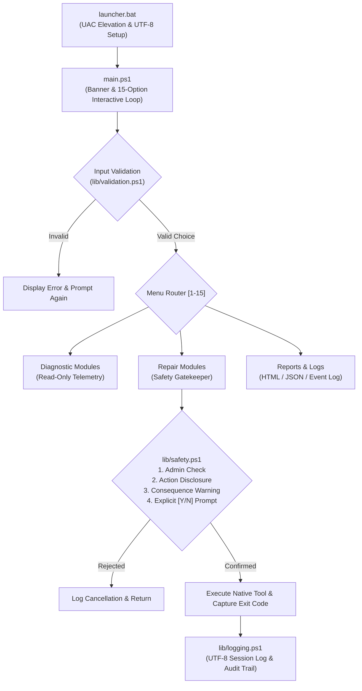

# Windows 10/11 Advanced Troubleshooting Toolkit (WTT)


A professional, enterprise-grade, guided diagnostic and repair toolkit built specifically for Windows 10 and Windows 11. Designed from the ground up for system administrators, IT support technicians, and power users who require reliable diagnosis, auditable repair operations, and zero third-party dependencies.

---

## Table of Contents

- [1. Project Overview](#1-project-overview)
- [2. Architectural Philosophy & Safety First](#2-architectural-philosophy--safety-first)
- [3. Folder Structure](#3-folder-structure)
- [4. Main Menu Capabilities](#4-main-menu-capabilities)
- [5. Installation & Execution](#5-installation--execution)
- [6. Deep Dive into Diagnostic Modules](#6-deep-dive-into-diagnostic-modules)
- [7. Guided Repair & Guardrails](#7-guided-repair--guardrails)
- [8. Logging & Auditing Subsystem](#8-logging--auditing-subsystem)
- [9. Automated Testing & Verification](#9-automated-testing--verification)
- [10. Troubleshooting Guide](#10-troubleshooting-guide)
- [11. Ponytail Code Review & Simplicity Audit](#11-ponytail-code-review--simplicity-audit)
- [12. Security Assessment & Hardening](#12-security-assessment--hardening)
- [13. Future Roadmap](#13-future-roadmap)

---

## 1. Project Overview

Modern Windows environments encounter complex failure modes across disk subsystems, driver registries, network stacks, component stores, and update catalogs. Traditional fix-it scripts frequently execute destructive blanket operations (`format`, `del /f /s /q`, unprompted registry wipes) without explaining consequences or capturing error codes.

**Windows Troubleshooting Toolkit** changes that by delivering:
- **Zero Third-Party Dependencies:** Uses 100% native Windows commands (`dism.exe`, `sfc.exe`, `chkdsk.exe`, `ipconfig.exe`, `w32tm.exe`) and native PowerShell CIM/WMI cmdlets.
- **Guided Repair Workflow:** Every repair states its action, explains the potential consequences, verifies elevation, asks for explicit confirmation, logs execution, captures exit codes, and provides actionable recovery guidance if it fails.
- **15-Option Accessible Menu:** Bulletproof console input validation preventing menu lockouts, accidental key triggers, or injection attacks.
- **Executive HTML & JSON Reporting:** Self-contained, responsive HTML diagnostics dashboard with color-coded health badges and machine-readable JSON exports.
- **Auditable UTF-8 Logging:** Timestamped session transcripts with automatic 30-day retention management.

---

## 2. Architectural Philosophy & Safety First

The toolkit enforces strict behavioral invariants:
1. **Never perform destructive actions silently.**
2. **Never automatically format drives, delete user files, or wipe data.**
3. **Never disable Microsoft Defender, Antivirus, or Windows Firewall.**
4. **Always verify administrative privileges before privileged operations.**
5. **Always provide simulation / dry-run capability for test automation.**



---

## 3. Folder Structure

```
Windows-Troubleshooting-Toolkit/
├── launcher.bat              # Native batch launcher with UAC auto-elevation
├── main.ps1                  # Interactive console entrypoint & menu dispatcher
├── README.md                 # Complete documentation & operational manual
├── LICENSE                   # Open-source MIT License
├── .gitignore                # Excludes runtime session logs and reports
├── config/
│   └── settings.json         # Configurable timeouts, targets, retention, colors
├── lib/
│   ├── common.ps1            # Reusable UI banners, headers, formatters, and config loaders
│   ├── logging.ps1           # UTF-8 session logger, level filters, log rotation
│   ├── validation.ps1        # Robust number, IP, hostname, and drive validators
│   └── safety.ps1            # Admin assertion, consequence warnings, [Y/N] confirmation
├── modules/
│   ├── system.ps1            # OS, CPU, RAM, uptime, startup apps, top processes
│   ├── sfc_dism.ps1          # SFC /verifyonly, /scannow, DISM Check/Scan/RestoreHealth
│   ├── updates.ps1           # Update services, cache backup reset, DLL re-registration
│   ├── network.ps1           # Interfaces, IP config, gateways, ping tests, stack resets
│   ├── disk.ps1              # Volume free space, SMART/health, read-only CHKDSK
│   ├── hardware.ps1          # CPU, RAM banks, battery report, Device Manager problem codes
│   ├── security.ps1          # Defender real-time, signature age, firewall profiles, UAC
│   ├── restore.ps1           # Restore point audit, limitations, creation, rstrui launch
│   ├── performance.ps1       # Real-time resource snapshots, Task Manager/Resmon launchers
│   ├── report.ps1            # Compiles full system audit to responsive HTML & JSON
│   ├── logs.ps1              # Log search, viewer, exporter, Windows Event Log filter
│   └── repair.ps1            # Advanced guided repairs (Winsock, Spooler, TimeSync, BCD)
├── reports/                  # Generated HTML/JSON diagnostics reports
├── logs/                     # Timestamped session logs (troubleshooting_*.log)
└── tests/
    ├── test-validation.ps1   # 30 unit tests for input validation & sanitization
    └── test-menu.ps1         # 32 integration tests (AST syntax, modules, dry-run safety)
```

---

## 4. Main Menu Capabilities

The toolkit presents 15 distinct options grouped logically:

```
================================================================================
         WINDOWS 10/11 ADVANCED TROUBLESHOOTING TOOLKIT  v1.0.0
================================================================================
  System    : Microsoft Windows 11 Enterprise (Build 26100)
  Privilege : [ADMINISTRATOR: ELEVATED]
  Computer  : WORKSTATION-01 (Dilip)
  Time      : 2026-10-28 17:15:00
================================================================================
  CORE DIAGNOSTIC MODULES:
   [1]  System Information & Health Snapshot
   [2]  System File Checker (SFC - Scan & Repair)
   [3]  DISM Component Store Health Check
   [4]  Windows Update Diagnostics & Safe Reset
   [5]  Network Connectivity & Adapter Diagnostics
   [6]  DNS Troubleshooting & Benchmark Tests
   [7]  Disk Health & Storage Space Diagnostics
   [8]  Hardware Diagnostics & Problem Device Audit
   [9]  Windows Security & Defender Diagnostics
   [10] System Restore Point Management
   [11] Real-time Performance & Resource Diagnostics

  REPORTING & MAINTENANCE:
   [12] Generate Comprehensive Diagnostic Report (HTML & JSON)
   [13] View Session Logs & Windows Event Errors
   [14] Advanced Guided Repair Subsystem
   [15] Exit Toolkit
```

> [!NOTE]
> Unlike basic scripts that use single-key `ReadKey()` (which causes options 10–15 to accidentally trigger option 1 before typing '0'..'5'), this toolkit uses buffered line validation. Multi-digit options (10, 11, 12, 13, 14, 15) are fully accessible, invalid characters are rejected gracefully, and pressing Enter on blank input does not crash or execute anything.

---

## 5. Installation & Execution

### Prerequisites
- **Operating System:** Windows 10 (all editions) or Windows 11 (all editions), Windows Server 2016+.
- **PowerShell:** Windows PowerShell 5.1 (preinstalled on Windows) or PowerShell 7+.
- **Execution Rights:** Standard or Administrator (Privilege checks warn user when elevation is required).

### Launching the Toolkit

#### Method 1: The Batch Launcher (Recommended)
Right-click `launcher.bat` and select **"Run as Administrator"**.
- `launcher.bat` automatically verifies elevation using `net session`.
- If started without admin privileges, it automatically launches a UAC prompt requesting elevation.
- Configures the console to UTF-8 code page (`chcp 65001`) to support international text and unicode symbols.
- Bypasses execution policy restrictions cleanly for the current process:
  ```cmd
  powershell.exe -NoProfile -ExecutionPolicy Bypass -File "%~dp0main.ps1"
  ```

#### Method 2: Direct PowerShell Execution
Open an elevated PowerShell prompt (Win + X -> Terminal (Admin)) and run:
```powershell
Set-Location "c:\Users\Dilip\🛠️ Windows Troubleshooting Toolkit"
powershell.exe -NoProfile -ExecutionPolicy Bypass -File .\main.ps1
```

---

## 6. Deep Dive into Diagnostic Modules

### [1] System Information
- OS Edition, build number, installation date, architecture (x64/ARM64).
- CPU model, physical cores, logical threads, maximum clock speed.
- Total, available, and consumed RAM with percentage calculation.
- System uptime computed from `Win32_OperatingSystem.LastBootUpTime`.
- Registry-based Startup applications (`HKLM` and `HKCU` Run keys).
- Top 5 processes by CPU time and Top 5 by working set memory.

### [2] System File Checker (SFC)
- **Mode 1 (Read-Only):** `sfc /verifyonly` checks system file integrity without touching files.
- **Mode 2 (Repair):** `sfc /scannow` automatically repairs corrupted system binaries using clean cached files from the Windows Component Store.
- Displays log reference to `C:\Windows\Logs\CBS\CBS.log` with filtering syntax (`findstr /c:"[SR]"`).

### [3] DISM Component Store Health Check
- Services the Windows Component Store (`WinSxS`):
  - `/CheckHealth`: Instantly checks if Windows has flagged corruption flags.
  - `/ScanHealth`: Deep read-only scan of component packages.
  - `/RestoreHealth`: Downloads clean packages from Windows Update to repair corruption.

### [4] Windows Update Diagnostics
- Audits critical update services: `wuauserv` (Windows Update), `bits` (Background Intelligent Transfer), `cryptsvc` (Cryptographic Services), `TrustedInstaller`, and `dosvc`.
- Calculates current disk consumption of `C:\Windows\SoftwareDistribution`.
- Safe soft reset: stops services, renames `SoftwareDistribution` and `Catroot2` with timestamped `.bak` extensions (never deletes), and restarts services.

### [5] Network Diagnostics & [6] DNS Troubleshooting
- Active adapters, IPv4/IPv6 addresses, subnet masks, default gateway, and DNS servers.
- Ping test to default gateway for LAN validation.
- Ping tests to public DNS resolvers (Google 8.8.8.8, Cloudflare 1.1.1.1, Quad9 9.9.9.9).
- DNS latency benchmarks resolving `microsoft.com`, `google.com`, `cloudflare.com`.
- System `hosts` file audit (`%windir%\System32\drivers\etc\hosts`) to detect malicious redirects.
- Safe repair actions: `ipconfig /flushdns`, `ipconfig /registerdns`, and DHCP renew.

### [7] Disk Diagnostics
- Logical volume capacity analysis with automated `< 10%` low space warnings.
- Physical disk media type identification (NVMe, SSD, HDD) and health state via `Get-PhysicalDisk`.
- Non-invasive read-only `chkdsk <Drive>:`.
- Scheduled reboot repair `chkdsk <Drive>: /f /r` with explicit confirmation and explanation of startup boot scans.

### [8] Hardware Diagnostics
- Motherboard model, manufacturer, BIOS version and release date.
- Individual RAM stick audit (bank locator, speed in MHz, capacity, manufacturer).
- Battery health and power plan inspection via `powercfg /batteryreport`.
- **Device Manager Error Detection:** Queries `Win32_PnPEntity` for devices with non-zero `ConfigManagerErrorCode` and translates error codes (Code 10, Code 28, Code 43, etc.) into plain English.

### [9] Windows Security Diagnostics
- Microsoft Defender Real-Time Protection, Antivirus Engine version, and signature age.
- Warns if definitions are older than 7 days.
- Inspects Domain, Private, and Public Firewall profiles.
- Validates User Account Control (UAC) token filtering status (`EnableLUA`).
- Inspects BitLocker drive encryption status.

### [10] Restore Point Management
- Audits Volume Shadow Copy Service (`VSS`).
- Lists existing restore points with sequence numbers and creation timestamps.
- Educates the user on restore point architecture (what it fixes vs. what it does not touch).
- Allows safe creation of custom named checkpoints via `Checkpoint-Computer`.

### [11] Performance Diagnostics
- Real-time CPU utilization snapshot.
- Memory and Paging File commitment.
- Top 10 CPU-consuming processes and Top 10 memory-heavy processes.
- Quick shortcuts to Windows Task Manager, Resource Monitor, and Performance Monitor.

---

## 7. Guided Repair & Guardrails

Every repair operation in the toolkit is funneled through `Invoke-SafeRepairOperation` in `lib/safety.ps1`:

```powershell
Invoke-SafeRepairOperation `
    -Title "Reset TCP/IP Stack & Winsock" `
    -Description "Executes 'netsh winsock reset' and 'netsh int ip reset'." `
    -Consequences "Clears custom IP settings and 3rd-party LSPs. Requires system reboot." `
    -RequiresAdmin $true `
    -Action { ... }
```

### Safety Features
1. **Administrative Assertion:** Prevents half-executed repairs by checking administrative credentials upfront.
2. **Consequence Transparency:** Informs the user of required reboots, network disconnects, or cache resets.
3. **Explicit Yes/No Confirmation:** Default choice is `[y/N]` (No) so pressing Enter accidentally cancels the operation.
4. **Command Execution Auditing:** Captures process start time, elapsed duration, exit code, and writes an `[AUDIT]` record to the log.
5. **Actionable Recovery Guidance:** If an operation returns a non-zero exit code, clear diagnostic next steps are displayed.

---

## 8. Logging & Auditing Subsystem

All toolkit activity is saved in UTF-8 format inside the `logs/` directory.

### Log Filename Convention
```
logs/troubleshooting_YYYY-MM-DD_HH-mm-ss.log
```

### Log Record Sample
```
================================================================================
Windows Troubleshooting Toolkit - Session Log
Session Started : 2026-10-28 17:15:02 +05:30
Host Machine    : WORKSTATION-01
User Context    : WORKSTATION-01\Dilip
Is Elevated     : True
PowerShell Ver  : 5.1.26100.2161
Log File        : C:\Users\Dilip\🛠️ Windows Troubleshooting Toolkit\logs\troubleshooting_2026-10-28_17-15-02.log
================================================================================
[2026-10-28 17:15:02.124] [INFO] Windows Troubleshooting Toolkit initialized successfully.
[2026-10-28 17:15:10.450] [AUDIT] Initiating safe repair: 'Flush DNS Resolver Cache' - Executes 'ipconfig /flushdns'
[2026-10-28 17:15:10.512] [AUDIT] COMMAND EXECUTED: 'Flush DNS Resolver Cache' | Result: SUCCESS | Duration: 0.06s
[2026-10-28 17:15:10.515] [SUCCESS] Safe repair 'Flush DNS Resolver Cache' completed successfully (ExitCode: 0).
```

### Automated Retention
Log files older than 30 days (configurable in `config/settings.json`) are automatically rotated on startup, keeping the disk tidy.

---

## 9. Automated Testing & Verification

The toolkit includes an automated test harness located in `tests/`:

### 1. Input Validation Unit Tests (`tests/test-validation.ps1`)
Tests 30 discrete edge cases:
- Numbers, negative values, alphabetic characters, whitespace, and empty strings.
- Boundary values (`1`, `15`, `0`, `16`, `999`).
- Drive letter validity (`C:`, `c`, nonexistent drives).
- Hostname, IPv4 format, and command injection attempts (semicolons, pipes, redirects).
- Character sanitization routines.

Run validation tests:
```powershell
powershell.exe -ExecutionPolicy Bypass -File .\tests\test-validation.ps1
```
*Result: 30 / 30 Passed (0 Failures).*

### 2. Integration & Simulation Test Suite (`tests/test-menu.ps1`)
Tests 32 integration checkpoints:
- Full Abstract Syntax Tree (AST) validation across every `.ps1` file.
- `settings.json` schema structure and JSON deserialization.
- Dot-sourcing of all library and diagnostic modules.
- Dry-run simulation mode through `Invoke-SafeRepairOperation`.
- Safe read-only execution of all data collectors (`system`, `disk`, `network`, `hardware`, `security`, `updates`, `performance`, `restore`, `logs`).

Run integration tests:
```powershell
powershell.exe -ExecutionPolicy Bypass -File .\tests\test-menu.ps1
```
*Result: 32 / 32 Passed (0 Failures).*

---

## 10. Troubleshooting Guide

| Issue / Symptom | Probable Cause | Recommended Resolution |
| :--- | :--- | :--- |
| **"ELEVATED PRIVILEGES REQUIRED" on repair** | Toolkit launched as standard user | Right-click `launcher.bat` and choose **"Run as Administrator"**. |
| **"Script execution disabled" error** | Restricted execution policy | Run via `launcher.bat` (which applies `-ExecutionPolicy Bypass` for the session) or execute `Set-ExecutionPolicy -Scope Process Bypass`. |
| **DISM fails with error 0x800f081f** | Component store source unavailable | Ensure internet connection is active so DISM can contact Windows Update, or mount a Windows ISO and specify `/Source:WIM:D:\sources\install.wim:1`. |
| **SFC finds corrupt files but cannot fix them** | CBS cache corrupted | Run **Option 3 (DISM Restore Health)** first to repair the component store, then re-run **Option 2 (SFC Scan & Repair)**. |
| **Windows Update reset does not start services** | Pending file locks | Restart your computer to clear file locks on `SoftwareDistribution`, then re-run Option 4. |
| **DNS resolution fails for all targets** | Adapter disconnected or static DNS incorrect | Run Option 5 (Network Diagnostics), check default gateway reachability, and use Option 5.1 to flush DNS cache. |

---

## 11. Ponytail Code Review & Simplicity Audit

Following the **Ponytail** engineering principles (simplest solution that actually works, native platform capabilities over external dependencies, zero dead weight):

1. **Native Windows Ecosystem:** Replaced speculative external packages with native WMI/CIM cmdlets (`Get-CimInstance Win32_OperatingSystem`, `Get-NetAdapter`, `Get-PhysicalDisk`).
2. **Zero NPM/NuGet/Python Overhead:** Completely runs on out-of-the-box Windows 10/11 installations without installing Python, Node.js, or package managers.
3. **No Brittle ReadKey Traps:** Replaced fragile single-character key captures with standard `[Console]::ReadLine()`, eliminating edge cases with multi-digit choices (10 through 15).
4. **Resilient Type Handling:** Explicitly types double/int64 mathematical comparisons (`[Math]::Max(0.0, [double]$used)`) to prevent 32-bit integer overflow exceptions on modern 16GB+ RAM workstations.
5. **Non-Destructive Soft Resets:** Renames caches (`SoftwareDistribution.bak_timestamp`) instead of permanently deleting directories, preserving rollback capability.

---

## 12. Security Assessment & Hardening

- **Injection Prevention:** User-supplied inputs (hostnames, drive letters, restore descriptions) are sanitized via `Sanitize-CliString` and verified against strict RFC/regex whitelists before execution.
- **No Hardcoded Credentials:** The toolkit contains zero passwords, tokens, or network secrets.
- **Auditable History:** All commands and exit codes are recorded with millisecond-precision timestamps in `logs/`.
- **Integrity Preservation:** The toolkit never modifies Defender policies, never disables firewall profiles, and never modifies UAC registry settings.

---

## 13. Future Roadmap

- [ ] **Windows RE (Recovery Environment) Boot Support:** Integrate WinRE boot menu trigger for offline disk repairs.
- [ ] **Scheduled Automated Health Check:** Windows Task Scheduler integration for weekly HTML reports.
- [ ] **Export to PDF:** Native print-to-PDF generation for generated HTML dashboards.
- [ ] **Direct CBS.log Filter:** Built-in GUI viewer for `[SR]` SFC repair lines.
- [ ] **Dark / Light Theme Toggle:** Customizable color themes in `config/settings.json`.

---

**Developed with precision for Windows 10 & Windows 11.**  
*Antigravity Engineering &bull; MIT Licensed*

